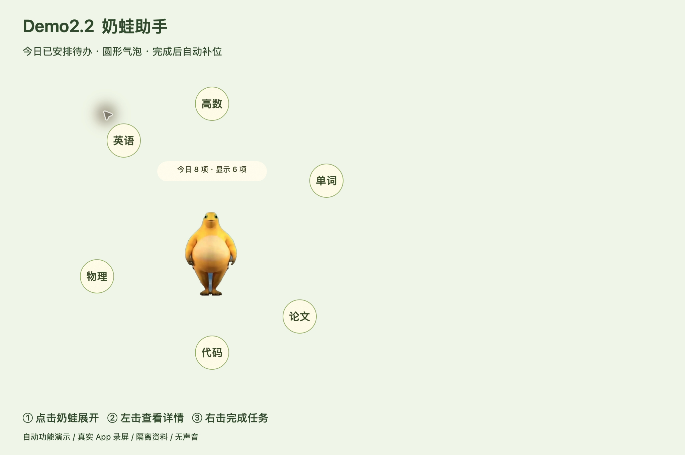

# Demo2.2 · 奶蛙助手

以 Demo2.1 为基线，保留原有助手、课表录入、课后作业询问和角色动作。本次主要更新：

- 点击奶蛙，在身旁展开今天**已经安排到日程中**的未完成任务，每个圆形气泡显示一到两个字。仅今天截止或逾期但没有安排的任务不显示；同一任务多个学习时段合并显示。
- 左击气泡查看任务详细；右击完成整个待办。最多显示 6 项，完成保存后自动补入隐藏任务，其他气泡保持位置。版本冲突会刷新记录并保留任务供重试。
- 将人工设定的“课表”和“待办与日程”分开。后者包含课程参考、固定事项及学习安排，可根据课表占用智能规划，校对确认后保存。
- 日程开始前约 5 分钟无声提醒，奶蛙变紫；点击肚皮打开预设网站或本机文件。未设置目标时进入待办与日程。
- 待机提示简化为“奶蛙”。

## 演示

[播放 Demo2.2 录屏](Demo2.2-演示.mp4)

约一分钟，使用 macOS 系统录屏生成。演示模式自动调用 App 的真实功能处理逻辑，展示读取 8 项当日任务、最多显示 6 个气泡、查看详情、完成写入、自动补位和空状态；不是鼠标操作录像。使用专用端口和临时数据库，不读取个人课表、模型配置或聊天，不调用付费模型，不录制声音。

## 运行和验证

[桌宠构建及使用说明](../../campus-pet/README.md) · [本版自检报告](VALIDATION.md)

本地交付目录 `Demo2.2/` 包含 App、压缩包、源码快照、演示视频和校验值。安装包仅在本机 Apple Silicon Mac 验证，需要 macOS 13 或更新版本，未做开发者签名或 Apple 公证。源码 PR 不包含个人配置、数据库、依赖目录或大体积安装包。
